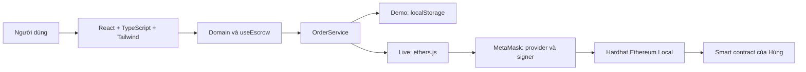
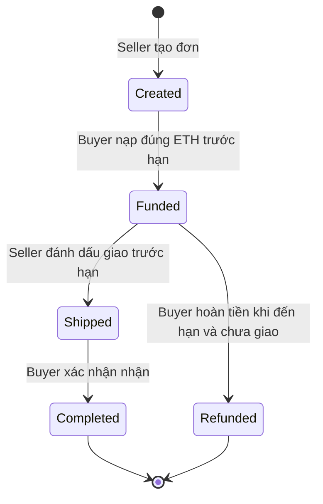

# Bản thảo báo cáo — Phần Huy

Đây là tài liệu mô tả phần frontend đã xây dựng. Phần kết nối và thực nghiệm với contract của Hùng phải bổ sung bằng kết quả chạy thực tế sau bàn giao; không xem demo là bằng chứng giao dịch blockchain.

## 1. Mục tiêu và phạm vi

Xây dựng giao diện ứng dụng ký quỹ ETH cho đơn hàng. Người bán tạo đơn, người mua nạp ký quỹ, người bán thông báo giao hàng, người mua xác nhận nhận để giải ngân; nếu đủ điều kiện thì người mua được hoàn tiền. Phiên bản đầu không có chat, đánh giá, nhiều token hay trọng tài. Dữ liệu nghiệp vụ cuối cùng nằm trên smart contract, không cần backend Node.js riêng.

## 2. Kiến trúc hệ thống

Component hiển thị dùng model thống nhất `Order`. `OrderService` cung cấp đọc danh sách, tạo đơn, thực hiện thao tác và đọc số dư. Hai implementation demo/live cho phép xây dựng và trình diễn giao diện trước khi có contract. `live.ts` là nơi ánh xạ dữ liệu ABI với model UI nên việc thay đổi tên hàm hoặc struct không lan ra các màn hình.

Provider phục vụ đọc blockchain. Signer đại diện tài khoản được MetaMask cấp quyền để ký giao dịch. Ứng dụng không giữ private key. Người dùng kiểm tra và xác nhận trên ví. ETH gửi vào contract thông qua payable function; số tiền xử lý bằng bigint/parseEther để tránh sai số số thực.

## 3. Thiết kế giao diện

Giao diện gồm thanh điều hướng trái, vùng chọn chế độ/ví trên đầu và nội dung chính. Thiết kế dùng nền sáng, xanh dương làm màu thao tác, trạng thái thể hiện bằng chữ và màu để dễ phân biệt. Các nút có focus bàn phím; form có nhãn; thông báo lỗi và transaction có vùng live để công nghệ hỗ trợ nhận biết.

- **Danh sách:** bốn số liệu tổng quan, bảng đơn, ô tìm theo tên/mã/ví, lọc trạng thái/vai trò, làm mới và liên kết chi tiết. Số ETH đang ký quỹ là tổng amount của đơn Funded hoặc Shipped, không phải tổng số dư ví.
- **Tạo đơn:** tên/mô tả, buyer, số ETH, hạn giao. Kiểm tra dữ liệu và xác nhận trước khi gọi contract. Ví hiện tại trở thành seller.
- **Chi tiết:** giá trị, vai trò, tiến trình, hai địa chỉ ví, thời hạn, mô tả và nhóm nút theo quyền. Xác nhận hành động trước khi gửi.
- **Hướng dẫn:** cách chạy demo, kết nối MetaMask, thông tin cấu hình và giới hạn nghiệp vụ.

Giao diện có breakpoint cho máy tính, tablet và điện thoại. Bảng giữ đủ cột và cho cuộn ngang khi không đủ chiều rộng.

## 4. Luồng nghiệp vụ

Created chưa có tiền ký quỹ. Funded và Shipped có tiền đang giữ. Completed đã giải ngân cho seller. Refunded đã trả cho buyer. Model này là quy tắc đề xuất để làm song song; khi nhận contract, nhóm phải đối chiếu các enum và điều kiện thực tế.

Tình huống Shipped nhưng buyer không phản hồi chưa có chính sách giải quyết, nên UI hiển thị lưu ý và không tự chuyển tiền. Quy tắc hoàn tiền, timeout và quyền phải được contract bảo vệ; ẩn nút frontend chỉ giúp giảm thao tác sai.

## 5. Kết nối ví và xử lý giao dịch

Frontend phát hiện MetaMask bằng thông báo EIP-6963, fallback injected provider. Khi người dùng bấm kết nối, ứng dụng yêu cầu `eth_requestAccounts`, đọc địa chỉ, chain ID và số dư ETH. Ứng dụng lắng nghe `accountsChanged`, `chainChanged`, `disconnect`; xóa dữ liệu cũ và đọc lại theo ngữ cảnh mới. Trạng thái sai mạng chặn thao tác và hướng dẫn chuyển sang mạng dự án.

Giao dịch đi qua bốn giai đoạn: chờ ký, chờ blockchain xác nhận, thành công hoặc thất bại. Adapter dùng `tx.wait(1)` và kiểm tra receipt status. Giao diện hiển thị hash; chỉ tải lại trạng thái sau xác nhận. Người dùng không thể bấm gửi lặp trong lúc chờ. Trường hợp thay thế giao dịch được phân biệt với hủy. Lỗi từ chối ký, thiếu tiền, sai cấu hình và revert được hiển thị riêng.

Sau receipt thành công, nếu tải lại dữ liệu thất bại, UI vẫn giữ thông báo giao dịch thành công và báo lỗi tải riêng. Khi live, danh sách làm mới mỗi 15 giây và có nút làm mới thủ công.

## 6. Hướng dẫn sử dụng

Xem README để cài Node, chạy npm install, dev và build. Để thử nhanh, chọn Demo, thực hiện một chu trình tạo → nạp → giao → nhận giữa hai vai trò; dùng đơn #005 để thử hoàn tiền. Muốn làm lại, dùng Khôi phục dữ liệu mẫu trong Hướng dẫn.

Để dùng blockchain, chạy Hardhat local do Hùng chuẩn bị, deploy contract, cập nhật ABI/adapter/địa chỉ trong project, thêm mạng và ví thử nghiệm vào MetaMask. Chọn chế độ MetaMask, kết nối và thực hiện cùng kịch bản với hai tài khoản khác nhau.

## 7. Kiểm thử và phần cần bổ sung

Các kiểm thử frontend tập trung validation, kiểm soát quyền, biên thời hạn, trạng thái giao dịch, tính chính xác ETH demo và ngăn xử lý lặp. Build production kiểm tra TypeScript và đóng gói tài nguyên. Test frontend không xác nhận bảo mật contract hoặc tính tương thích với ABI chưa bàn giao.

Sau khi có contract, bổ sung: địa chỉ deploy, chain ID, commit contract, ABI, kết quả test hai ví, ảnh MetaMask/receipt, ảnh từng màn hình và bảng kết quả các tình huống lỗi theo `DEMO_AND_TESTING.md`. Không ghi “đã giao dịch thành công trên blockchain” nếu mới chạy demo.

## 8. Tài liệu tham khảo

- React: https://react.dev/learn
- Vite: https://vite.dev/guide/
- Tailwind CSS: https://tailwindcss.com/docs/installation/using-vite
- ethers v6: https://docs.ethers.org/v6/getting-started/
- MetaMask provider: https://docs.metamask.io/metamask-connect/evm/reference/provider-api/
